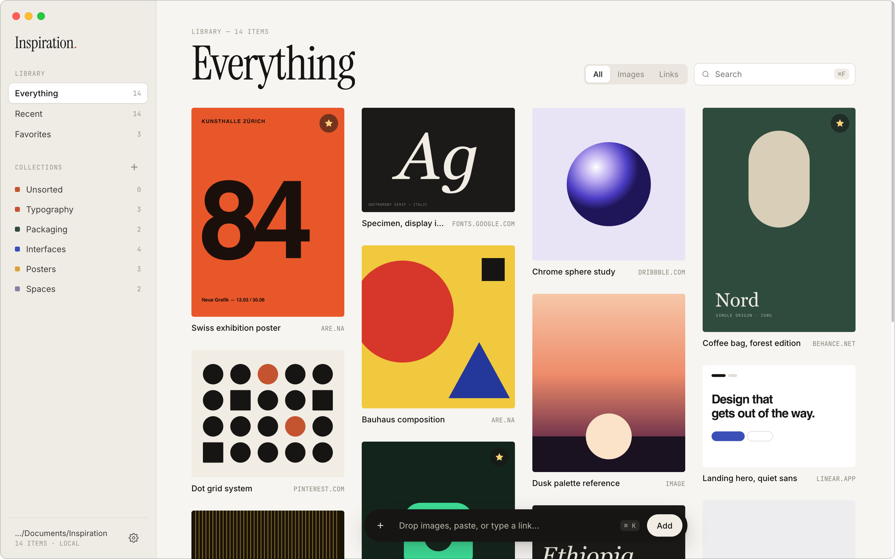
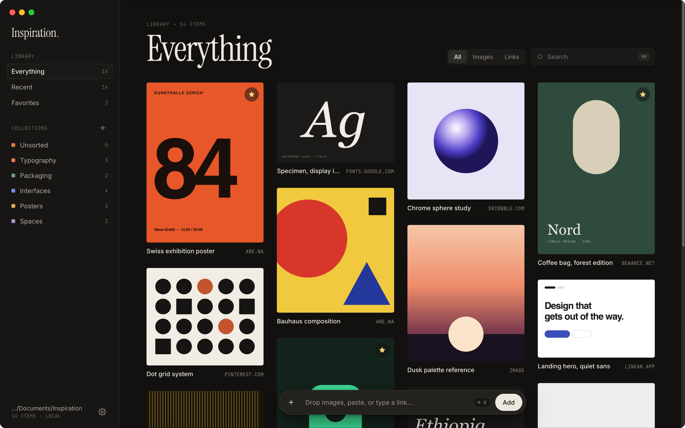
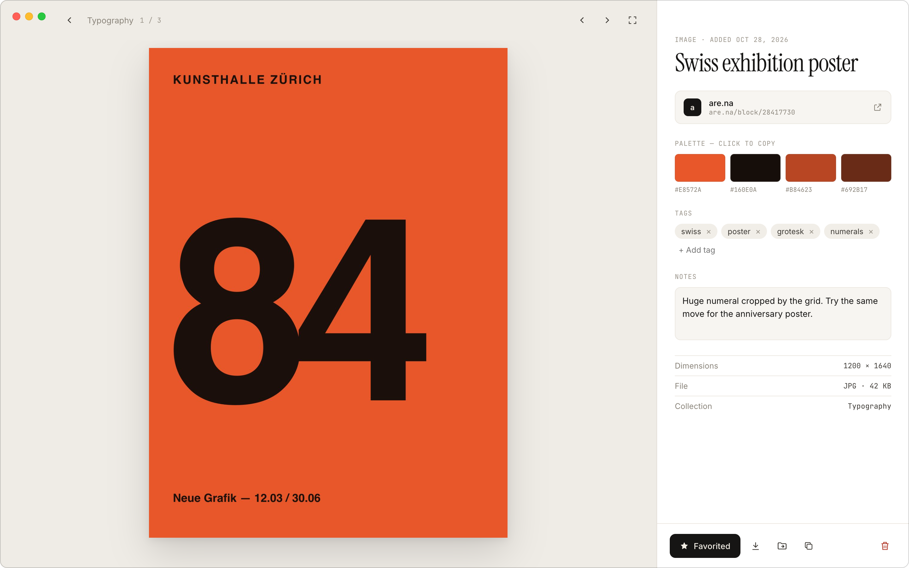
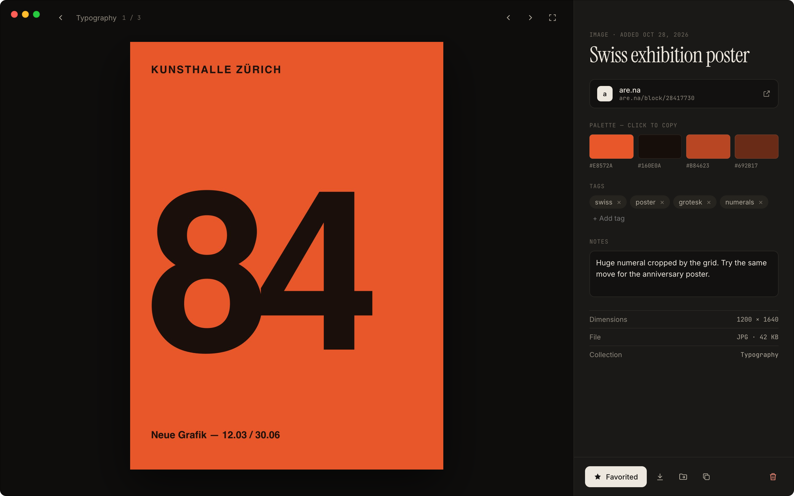

# Inspiration

A quiet desktop app for collecting visual inspiration: images, links and notes, organized into collections. Everything stays in one folder on your Mac.

<table>
  <tr>
    <td></td>
    <td></td>
  </tr>
  <tr>
    <td></td>
    <td></td>
  </tr>
</table>

## Install

1. Download the latest `.dmg` from [Releases](https://github.com/lovromaricic/inspiration/releases).
2. Open it and drag **Inspiration** into **Applications**.

Requires a Mac with Apple silicon (M1 or later).

> [!NOTE]
> The app isn't notarized by Apple yet, so the first time you open it macOS says it can't verify that the app is free of malware. Click **Done**, then go to **System Settings › Privacy & Security**, scroll down, and click **Open Anyway** next to the message about Inspiration. You only need to do this once.
>
> Prefer not to? Build it yourself from source (see below); apps you build on your own Mac open normally.

## Features

- Drop, paste (⌘V) or pick images; paste or type links (⌘K) to save a page with its cover image
- Collections, favorites, tags, notes and search
- Main colors pulled out of every image (click a swatch to copy its hex code)
- Light and dark themes that follow macOS, plus accent color, grid density and captions in Settings
- Library stored locally in a folder you choose (SQLite database plus an `images` folder)

## Development

```bash
npm install
npm start
```

## Build

```bash
npm run build
```

Builds an Apple silicon `.dmg` into `dist/` with electron-builder. To share it without the **Open Anyway** step, it needs to be signed with a Developer ID certificate and notarized by Apple.

## Project structure

| File | Purpose |
|---|---|
| `main.js` | Electron main process: window, storage setup, image processing, link previews |
| `database.js` | SQLite schema, migrations and queries |
| `preload.js` | The only bridge between the sandboxed page and the main process |
| `index.html`, `style.css`, `renderer.js` | The interface |
| `fonts/` | Bundled Instrument Serif, Inter and JetBrains Mono |
| `assets/` | App icon and installer background |

## Fonts

The bundled fonts are licensed under the SIL Open Font License 1.1; their license files are in `fonts/`.
